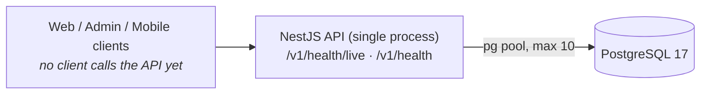
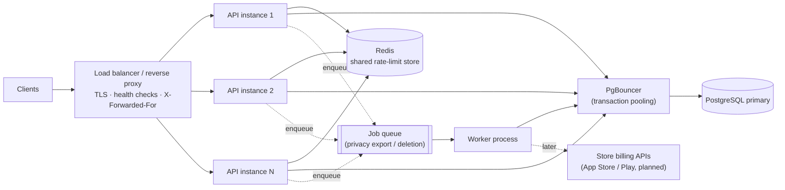

# Scalability Review

Date: 2026-10-18. Each statement is labelled **[Verified]** (code inspection or a measured
result in `LOAD_TEST_REPORT.md`), **[Estimate]** or **[Recommendation]**.

## 1. Current architecture

**[Verified]** One NestJS process (`node dist/main.js`, port 4000), one PostgreSQL. No reverse
proxy, load balancer, container image, process manager, cache, queue, background workers or
scheduled jobs exist in the repository. `infra/deployment/` is empty; `infra/docker/` only runs
local Postgres. No deployment platform is chosen, so none is assumed here.

### Proposed (nothing below is implemented)

Redis, PgBouncer, the queue and the worker are **proposals**, to be introduced only when the
triggers in §5 are met. The billing integration is in the schema (`subscriptions`,
`subscription_events`) but has no code.

## 2. What happens when 1,000 users arrive at once

**[Verified, local]** On the endpoints that exist, a single process on an Apple M1 stayed
stable: no errors at 1,000 VUs in sustained, spike and stress runs (the soak run was invalidated by system sleep). Liveness p95 was 1–2 ms
at about 400 RPS, and the process handled about 5,000–6,300 RPS in closed-loop stress.

**[Estimate]** That result does not transfer to the real product. The two health endpoints do
almost nothing. Real requests will add a session lookup, one or more Prisma queries and
JSON serialisation, probably costing 5–50× more CPU and DB time each. Capacity has to be
re-measured as each module ships.

**[Verified, by code + test] The first thing that will break in a real deployment is rate
limiting, not capacity.** The throttler keys on `req.ip`, and Express `trust proxy` is off.
Behind any load balancer or reverse proxy, `req.ip` is the proxy's address. All 1,000 users
then share **one** 120 req/min bucket and almost every request gets 429 within seconds.
`test/rate-limit.e2e-spec.ts` shows the 121st request from one IP is rejected. **Update
2026-10-18:** with the product modules shipped, this now applies to every route except health,
and Better Auth's own sign-in/sign-up limiter (5 per minute per IP) has the same IP dependency.
Fix it before any proxied deployment.

## 3. Bottlenecks and evidence

| # | Bottleneck | Evidence | Label |
|---|---|---|---|
| B1 | Per-IP throttle behind a proxy (see §2) | `app.module.ts` (`ThrottlerModule`, IP tracker), no `trust proxy` in `setup-app.ts`; rate-limit e2e test | Verified (code) / Estimate (impact) |
| B2 | The DB round-trip path limits readiness throughput: ~2,500–3,200 `SELECT 1`/s, readiness p50 276–326 ms under closed-loop load, while liveness on the same process stays at p50 3–9 ms | Stress runs; DB connections pinned at the pool maximum | Verified (local) |
| B3 | **Pool size is not the limit here.** Raising `DATABASE_POOL_MAX` 10 → 20 lowered throughput (6,353 → 5,447 RPS) and raised readiness p50 (276 → 326 ms). The limit is per-query overhead in the single event loop (Prisma + pg) and the Docker Desktop network hop | `stress-after-pool10` vs `stress-after-pool20` | Verified (local) |
| B4 | One process uses about one core (API CPU 107–111% average in stress; the extra comes from libuv/GC threads). More cores need more processes | `*.resources.csv` | Verified |
| B5 | In-memory throttler storage: each instance counts separately, so N instances allow N×120/min per IP | `ThrottlerModule.forRoot` without storage | Verified (code) |
| B6 | Postgres `max_connections` = 100 (local). Instances × `DATABASE_POOL_MAX` must stay below it, with headroom for migrations and admin | `SHOW max_connections` | Verified (local) / production value unknown |
| B7 | Readiness is public, unthrottled and costs a DB query, so it can amplify load onto the DB | `health.controller.ts` | Verified (code) |

Tail-latency spikes in the first (baseline) sustained run were traced to the test machine.
iCloud Drive processes used about 2.7 cores, and event-loop stalls reached 425 ms while the
longest GC pause was 67 ms. They are not counted as an application bottleneck. See the load
report.

## 4. Assessment by area

| Area | Status today | Notes |
|---|---|---|
| Horizontal scaling | **Possible**: the app is stateless. No sessions, uploads or local files; request ids are per request | Throttler state (B5) is the only per-instance state |
| Load balancer + health checks | **Missing** (no deployment config) | Use `/v1/health/live` for liveness and `/v1/health` for readiness |
| Liveness / readiness | **Present**. Readiness now times out after 2 s (was unbounded) | §6 |
| Sticky sessions | Not needed | Better Auth sessions will live in Postgres (`auth_sessions`) |
| DB pooling | node-postgres pool, max 10 per instance. **Now configurable** (`DATABASE_POOL_MAX`), with a 5 s acquire timeout (`DATABASE_POOL_TIMEOUT_MS`; previously waited forever) | Add PgBouncer when instances × pool approaches `max_connections` |
| Query optimisation / indexes | Schema has sensible composite indexes for planned access paths (owner + date DESC, consent latest-by-purpose, partial unique index for published article). Nothing to optimise yet: no queries besides `SELECT 1` | Review with `EXPLAIN ANALYZE` per module. Possible future gap: `reminders` has no index on `user_id`/`anonymous_session_id` (Postgres does not index FK columns automatically) |
| Caching | None. Nothing to cache yet | Good candidates later: published articles and readiness tasks (read-mostly, versioned), entitlement lookups (short TTL) |
| Rate limiting | Global 120/min per IP on all non-health routes; tighter on anonymous-session creation, link, export, deletion; Better Auth limits sign-in/up. In-memory, per instance | Fix B1/B5 before launch |
| Timeouts | Node defaults: `requestTimeout` 300 s, `headersTimeout` 60 s, `keepAliveTimeout` 5 s. Pool acquire now 5 s. No statement timeout | Recommendation: Postgres `statement_timeout` per role; set Node `keepAliveTimeout` above the LB idle timeout to avoid 502 races |
| Retries / backoff | None (no external calls) | Add with idempotency keys when billing webhooks/verification land (`subscription_events.provider_event_id` is already the dedupe key) |
| Queues for expensive work | None | Privacy export/deletion (`privacy_jobs`) should run in a worker, not in requests |
| Graceful shutdown | `enableShutdownHooks()` closes the server and Prisma on SIGTERM | Recommendation: on SIGTERM, make readiness return 503 first, wait about one LB health-check interval, then close, so in-flight traffic drains |
| Third-party limits | N/A today | Store APIs: queue and retry with backoff |
| CPU / RAM / network | RSS 100–350 MB under load; no growth within the 7.5-min sustained run. Soak (memory-leak check) **not validly executed** | One core per process: run one process per vCPU |

## 5. Required before handling 1,000 concurrent users reliably

Must-do before launch (in order):

1. **[Recommendation] Fix client identification behind the proxy.** Set Express `trust proxy`
   to the exact proxy hop count or CIDR (never `true` blindly, because `X-Forwarded-For` can be
   spoofed), and/or key authenticated routes by user id. Decide once the platform is chosen.
2. **[Recommendation] Shared throttler storage** (e.g. `@nest-lab/throttler-storage-redis`) once
   there is more than one instance.
3. **[Recommendation] At least 2 instances behind a load balancer** with the health checks above,
   for availability during deploys. One instance is a single point of failure, whatever its
   capacity.
4. **[Recommendation] Re-run `tests/load` on staging** with the real auth and cycle endpoints,
   and set capacity from that, not from health-only numbers.
5. **[Recommendation] Observability** (see `DEPLOYMENT_RECOMMENDATIONS.md` §3): you can't
   operate at 1,000 users without request metrics and pool saturation data.

Later, when triggers are met:

| Change | Trigger |
|---|---|
| PgBouncer (transaction mode) | instances × pool > ~70% of `max_connections` |
| Read replica | sustained DB CPU > 60% with read-heavy mix |
| Response caching (articles/tasks) | content endpoints shipped and measured hot |
| Queue + worker | first export/deletion job implemented |
| Short-TTL readiness cache (~1 s) | readiness traffic measurably loads the DB |

## 6. Infrastructure changes and cost

**[Estimate]** Not enough information to price: no cloud provider, region, traffic profile or
budget is defined. Sizing guidance independent of provider:

- Health-only traffic for 1,000 users (about 500 RPS with 2 s think time) needs well under one
  vCPU. Real endpoints will need more. Start with 2 × (1 vCPU, 512 MB–1 GB) instances, measure,
  and scale on CPU > 60–70%.
- Postgres: a small managed instance with automated backups and PITR. Health data needs
  encryption at rest and in transit regardless of size.
- Redis: the smallest managed tier is enough for rate-limit counters.

No infrastructure was installed and no production setting was changed.
