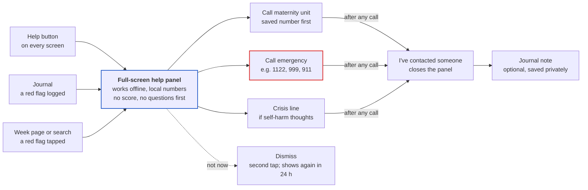
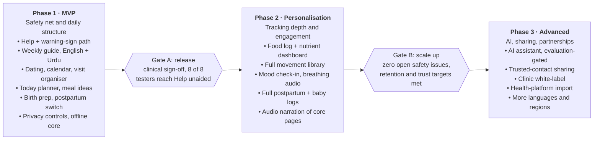

# Pregnancy Companion App — Product Research & Requirements

Oct 18, 2026 · Living copy: [Claude Doc](https://claude.ai/code/artifact/61c3d196-8d40-41ab-a179-5cbf5795c880). This file is an export; edit one and re-export to keep them in sync.

## How to read this document

Every claim that shapes medical content carries one of three labels, so clinicians reviewing this plan can see what is settled and what is a product bet.

| Label | Meaning | What it needs before release |
| --- | --- | --- |
| **Verified** | Stated by a named guideline body (WHO, ACOG, NHS/NICE, CDC, IOM/NASEM, national ministry) on a page cited in Sources | Clinical sign-off on the wording, plus a review date |
| **Product idea** | A design proposal from this plan | Usability testing; clinical review if it touches health content |
| **Assumption** | Something believed true about users or the market but not yet evidenced | A research question in section 19 |

Three rules hold everywhere:

- The app educates and organises. It never diagnoses, prescribes, interprets test results or tells someone a symptom is harmless.
- Guidance differs by country, clinician and pregnancy. Defaults follow WHO, and local schedules (for example Pakistan, UK, US) replace them where the user picks a region.
- Numbers (calories, weeks, sizes) are shown as ranges and estimates, never as precise targets.

**Relationship to the existing codebase.** The current `preconception-platform` repo serves people planning a pregnancy. This plan describes a pregnancy-and-postpartum product. Most of the platform carries over unchanged: identity (registered and anonymous), consent gating for health data, the clinically reviewed content workflow, reminders, export and deletion, and the audit trail. New domain modules are needed for pregnancy dating, the weekly guide, nutrition, appointments, symptoms with a warning-sign workflow, and postpartum mode.

## 1. Executive summary

Build a free, private pregnancy companion that answers one question every day: *what matters for me today, and when do I need a professional?* The first release should ship six things well rather than everything thinly: dating and a weekly guide, a gentle daily planner, an appointment and supplement organiser, a symptom journal with a clinically reviewed warning-sign path, birth preparation, and a postpartum switch.

**Who it is for.** First-time mothers, women living alone or far from family, and women whose care system gives them little explanation between visits. Pakistan and South Asia are the first localisation, in English and Urdu, with local foods, local emergency numbers and local appointment norms.

**What makes it different** (product ideas, tested against competitor evidence in section 13):

- **Action, not trivia.** Each day shows two or three things to do, learn or ask, instead of a fetal size comparison.
- **Safety you can find in one tap.** A permanent "Get help now" entry lists warning signs and local numbers. It never sits behind a chatbot or a score.
- **Local by default.** Roti, daal and dahi rather than imported recipes; a Pakistan appointment template; Urdu; low-bandwidth and offline core content.
- **Trust as the business model.** No advertising targeted on pregnancy data, no data sales, anonymous use allowed, and export or deletion in two taps.
- **No guilt.** Every task can be skipped, edited or switched off, and missed days are never counted against the user.

**What it will not do.** It will not diagnose, prescribe doses, interpret test results, count kicks as a safety check, promise outcomes from exercise or diet, or offer an AI assistant in the first release.

**Sustainability.** Start free, funded by grants and partnerships with maternal-health organisations. Add a small number of contextual, non-targeted, pre-approved sponsorships later, with no ads near medical or warning content. Section 17 explains why behaviourally targeted advertising is a poor fit for this audience.

## 2. The pregnancy journey

Pregnancy lasts about 40 weeks from the first day of the last period, and a birth anywhere from 37 to 42 weeks is normal (ACOG; NHS). The stages below describe what is *typical*; every pregnancy, care system and clinician plan differs, and high-risk pregnancies follow their clinician's schedule. Facts marked ✓ are verified in the sources listed under the stage; everything else is general educational framing that the clinical reviewers must confirm.

### Before the first appointment (≈ weeks 4–8)

- **Body:** missed period, breast tenderness, tiredness, nausea may start, frequent urination.
- **Baby:** brain, spine and heart tissue begin to form ✓ ([ACOG](https://www.acog.org/womens-health/faqs/how-your-fetus-grows-during-pregnancy)).
- **Do:** start or continue folic acid; WHO recommends iron and folic acid supplements in pregnancy ✓ ([WHO](https://www.who.int/news/item/07-11-2016-new-guidelines-on-antenatal-care-for-a-positive-pregnancy-experience)). Book a first visit, within 12 weeks per WHO ✓ and at 8–12 weeks in the NHS ✓. Stop alcohol, smoking and other substances, and check medicines with a clinician.
- **Learn:** food safety, what's normal, and the warning signs (section 9), such as bleeding or severe pain.
- **Prepare:** choose where to get care; save the maternity contact.

### First trimester (to 13w6d ✓)

- **Body:** nausea and vomiting, fatigue, mood changes, food aversions.
- **Baby:** end of the embryonic period at about 10 weeks from the LMP; by weeks 9–12 the kidneys make urine and the pancreas makes insulin ✓.
- **Visits:** booking (blood pressure, urine, blood group) and the dating scan at 11–14 weeks in the NHS ✓; the WHO first contact ✓. Screening options are discussed.
- **Nutrition:** small frequent meals for nausea, hydration, folic acid; no extra calories needed yet for most women (section 7).
- **Activity:** continue gentle activity if she feels well (section 8).
- **Urgent:** heavy bleeding, severe one-sided pain, fainting, severe vomiting that stops her keeping fluids down.

### Second trimester (14w0d–27w6d ✓)

- **Body:** energy often returns; the bump shows; backache, heartburn, constipation; first movements usually felt at 16–24 weeks, later in a first pregnancy ✓ ([NHS](https://www.nhs.uk/pregnancy/keeping-well/your-babys-movements/)).
- **Baby:** ears, nose and lips visible on ultrasound (17–20); stronger kicks (21–24); lungs begin making surfactant (25–28) ✓.
- **Visits:** anomaly scan 18–21 weeks (NHS) ✓; glucose testing at 24–28 weeks where advised ✓ ([ACOG](https://www.acog.org/womens-health/faqs/gestational-diabetes)); WHO contacts at 20 and 26 ✓; whooping-cough vaccine discussion (from 16 weeks in the UK) ✓.
- **Learn:** her baby's movement pattern; what to do if movements change.
- **Prepare:** maternity leave, budget, antenatal classes.

### Third trimester (28w0d onward ✓)

- **Body:** breathlessness, swelling, poor sleep, Braxton Hicks tightenings, pelvic discomfort.
- **Baby:** eyelids open and close; may turn head-down at 33–36 weeks ✓.
- **Visits:** more frequent contacts (WHO 30, 34, 36, 38, 40) ✓; Group B strep culture at 36–37 weeks in the US ✓; RSV vaccine discussion ✓.
- **Prepare:** hospital bag, documents, transport, birth preferences, feeding plan.
- **Urgent:** reduced or changed movements (call the same day, don't wait), bleeding, waters breaking, severe headache, vision changes, sudden swelling of face or hands ✓ ([CDC](https://www.cdc.gov/hearher/maternal-warning-signs/index.html), [NHS](https://www.nhs.uk/pregnancy/common-symptoms/pregnancy-symptoms-you-need-to-get-help-for/)).

### Labour and birth

- **Signs:** regular contractions, a "show", backache, waters breaking ✓ ([NHS](https://www.nhs.uk/pregnancy/labour-and-birth/signs-of-labour/signs-that-labour-has-begun/)).
- **When to call:** see section 12; the app never decides whether labour has begun.
- **Typical duration:** first stage often 8–18 hours for a first baby and about 5–12 hours for later births ✓ ([NHS](https://www.nhs.uk/pregnancy/labour-and-birth/what-happens/the-stages-of-labour-and-birth/)), shown as a range, never an expectation.

### Early postpartum (birth → 6 weeks, continuing to 1 year)

- **Body:** bleeding, uterine cramping, perineal or wound healing, breast changes, exhaustion.
- **Care:** WHO recommends at least four contacts in the first 6 weeks ✓ ([WHO](https://www.who.int/news/item/30-03-2022-who-urges-quality-care-for-women-and-newborns-in-critical-first-weeks-after-childbirth)).
- **Baby:** feeding (exclusive breastfeeding for 6 months is the WHO recommendation ✓), safe sleep ✓, newborn checks.
- **Urgent:** heavy bleeding, fever, severe headache, breathing problems, leg swelling or pain, thoughts of self-harm ✓ (CDC, up to 1 year).

### First-time vs experienced mothers

|  | First pregnancy | Been pregnant before |
| --- | --- | --- |
| Movements | May not be felt until after 20 weeks ✓ (NHS) | Often recognised earlier |
| Visits | NHS: at least 10 appointments, including 25 and 31 weeks ✓ | NHS: at least 7 ✓ |
| Labour | First stage often 8–18 h ✓ | Often 5–12 h ✓ |
| Content need | Explanations, what's normal, preparation lists | Shorter updates, what's different this time, managing with other children, earlier-pregnancy complications to mention to the clinician |

**High-risk pregnancies** (for example twins, diabetes, high blood pressure, a previous preterm birth): the app removes generic schedules and suggestions the user flags as not applicable, and shows a standing note: *"Your care team's plan comes first."*

## 3. Personas and their biggest problems

All five personas are **assumptions** built from the brief. They must be validated in interviews (section 19) before the roadmap is locked.

| Persona | Situation | Biggest problems | What would help most |
| --- | --- | --- | --- |
| **Ayesha, 24, Lahore** · first pregnancy | Lives with her husband's family; first visit at a busy public hospital; uses a mid-range Android phone on mobile data | Doesn't know what is normal; short consultations with little explanation; conflicting advice at home | Plain Urdu explanations, "questions to ask" lists, a clear warning-sign screen |
| **Sara, 31, Dubai** · first pregnancy, abroad | Works full time; family in Pakistan; partner travels | Isolation; nobody to ask at night; anxiety about warning signs | Daily planner, one-tap help with local (UAE) numbers, journalling, a trusted-contact share |
| **Hina, 35, Karachi** · third pregnancy | Two children; little time; gestational diabetes in an earlier pregnancy | Generic "first-time" content wastes her time; needs appointment and glucose-visit organising | "Experienced mother" mode, an appointment tracker, food logging around her clinician's plan |
| **Maria, 28, Manchester** · first pregnancy | NHS care; vegetarian; follows lots of social media | Too much information of uneven quality; wants it evidence-based and local to the NHS | NHS schedule template, sourced content with review dates, vegetarian meal ideas |
| **Zainab, 19, rural Punjab** · first pregnancy | Limited literacy; shared phone; few antenatal visits | Can't read long text; privacy on a shared device; far from a facility | Audio and pictures, offline content, app lock, emergency transport planning |

The shared need behind all five is **confidence about the next step**: what to do today, what to ask at the next visit, and when to stop reading and call someone.

## 4. Feature inventory

34 features in 14 modules. About 25 are MVP in whole or in part, chosen because they directly reduce uncertainty or risk for someone with no one to ask; section 15 sizes that set. Everything here is a **product idea** unless the safety column cites a guideline topic, which section 16 maps to sources.

| Module | Feature | User problem solved | How it works | Stage | Personalization | Medical safety | Phase | Success metric |
| --- | --- | --- | --- | --- | --- | --- | --- | --- |
| Onboarding | Pregnancy dating | "How far along am I?" | Due date, LMP or clinician-given week → estimated week and due date; editable at any time | Any | Due date, LMP, cycle length, clinician update | Labelled an estimate; a clinician's scan date replaces the LMP date | MVP | % of users with a dated pregnancy after onboarding |
| Onboarding | Minimal profile | Generic content | 6 essential questions plus optional extras (section 2) | Any | Region, language, first pregnancy, diet | No diagnostic questions; health fields optional | MVP | Onboarding completion rate |
| Onboarding | Clinician restrictions | Unsafe generic advice | User ticks "my clinician told me to avoid exercise / certain foods" | Any | Restriction flags | Restrictions only remove content; they never add medical advice | MVP | % of flagged users seeing no conflicting tips |
| Weekly guide | Week page | "What is happening this week?" | Baby, body, symptoms, nutrition, activity, visits, questions, checklist, message | Week 4 to postpartum | Week, first vs subsequent pregnancy, region | Reviewed content only; sizes shown as approximate | MVP | Weekly opens per active user |
| Weekly guide | Pregnancy calendar | Losing track of dates | Month view of visits, reminders, milestones, prep tasks | All | Due date and care plan | Dates move when the due date changes | MVP | Calendar items created per user |
| Daily planner | Today screen | "What should I do today?" | 3 to 5 cards: update, meal idea, movement, tip, one task | All | Week, diet, restrictions, notification settings | No card contradicts a restriction flag | MVP | D7/D30 retention; cards completed per week |
| Daily planner | Skip / edit / disable | Guilt and overload | Every card can be skipped, snoozed or turned off by category | All | Saved preferences | None | MVP | Low share of users disabling the whole planner |
| Daily planner | Evening check-in | No reflection or pattern | Mood, energy, optional symptoms, water and meals | All | Opt-in | Low mood triggers support content, not a diagnosis (section 9) | Phase 2 | Check-in rate among opted-in users |
| Nutrition | Meal ideas | "What should I eat?" | Local, affordable breakfast/lunch/dinner/snack suggestions | All | Diet pattern, allergies, region, budget | Food-safety rules applied; no weight-loss framing | MVP | Saved or cooked meal ideas |
| Nutrition | Food safety guide | Unsafe foods | Searchable "can I eat…?" list with reasons | All | Region (local foods) | Guideline-sourced, reviewed yearly | MVP | Searches with a result |
| Nutrition | Food log | No view of intake | Search a local food database, portions, favourites, manual entry | All | Region foods | Estimates shown as ranges; no calorie deficits | Phase 2 | Days logged per week |
| Nutrition | Nutrient dashboard | Not knowing what's missing | Progress toward reference ranges for protein, fibre, iron, calcium, folate, vitamin D, water | All | Trimester, multiples, clinician targets | Reference values, not targets; clinician values override | Phase 2 | % of users acting on a suggestion |
| Nutrition | Shareable summary | Hard to discuss diet with a clinician | PDF or image of 7-day patterns | All | User chooses what to share | Explicit consent per share | Phase 3 | Summaries shared |
| Activity | Movement library | "What exercise is safe?" | Walking, stretching, pregnancy yoga, pelvic floor, breathing; steps, duration, trimester notes | All | Activity level, restriction flags | Contraindication screen; stop-signs on every exercise | MVP (walking, pelvic floor, breathing); Phase 2 (full library) | Sessions started; no use by flagged users |
| Symptoms | Symptom journal | Forgetting what to tell the clinician | Log symptom, severity, duration, notes; see patterns | All | Week-relevant symptom list | Educational info only; never a cause or diagnosis | MVP | Entries per active user |
| Symptoms | Warning-sign path | Not knowing when it is urgent | Red-flag symptoms open a full-screen "contact care now" panel with local numbers | All | Region numbers, saved maternity unit | Fixed, reviewed rules; no scoring; can't be dismissed silently | MVP | Time to reach call button; clinician audit of wording |
| Symptoms | Get help now | Panic, searching for numbers | Permanent button: emergency number, maternity unit, warning-sign list | All | Saved contacts | Works offline; reviewed every 6 months | MVP | Reachable in 1 tap from every screen |
| Appointments | Visit organiser | Missed visits, forgotten questions | Visits with date, type, questions, documents, notes, outcome | All | Region template (WHO, Pakistan, NHS, US) | Template is a suggestion; the clinician's plan wins | MVP | Visits logged; questions taken to visits |
| Appointments | Supplement and medicine reminders | Forgetting doses | User enters what was prescribed and the schedule; reminders only | All | User-entered | Never suggests doses; "don't change without your clinician" | MVP | Reminder adherence (self-reported) |
| Appointments | Visit summary notes | Forgetting what was said | Free-text and photo of the visit card (stored privately) | All | — | No interpretation of results | Phase 2 | Notes per visit |
| Emotional | Mood check-in and journal | Isolation, unspoken worries | Optional daily mood, private journal | All | Opt-in | Persistent low mood or self-harm thoughts → support and crisis numbers | Phase 2 (check-in); MVP (crisis links) | Opt-in rate; support resources opened |
| Emotional | Breathing and relaxation | Stress, poor sleep | 1 to 5 minute guided audio | All | Language | No outcome claims | Phase 2 | Sessions completed |
| Emotional | Trusted contact | Nobody to tell | Share chosen items (due date, visit dates, help button) with one person | All | Per-item consent | Health data never shared by default; revocable | Phase 3 | Users with a trusted contact |
| Baby | Development explainer | "How is my baby doing?" | Weekly milestones in simple language and illustrations | Weeks 4–40 | Week | Sizes approximate; no reassurance about an individual baby | MVP (inside the week page) | Engagement with baby cards |
| Baby | Movement awareness | Not knowing what to do if movements change | Education from \~week 16; "movements reduced or changed? Call now" | From first movements | Week | No kick-count score as a safety check | MVP | Call button taps from this screen |
| Birth prep | Hospital bag and documents | Last-minute panic | Customisable checklist, budget options | From \~week 28 | Hospital, budget, region | None | MVP | Checklist completion by week 36 |
| Birth prep | Birth plan and transport | No plan for getting to hospital | Preferences, questions, route, who drives, numbers | From \~week 28 | Region | "The app can't tell if you are in labour" | MVP | Plans completed |
| Birth prep | Labour signs guide | When to go in | Signs and when to call the maternity unit | From \~week 34 | Region | Reviewed; errs toward calling | MVP | Views in weeks 36–41 |
| Postpartum | Postpartum mode | App ends at birth | One tap "Baby is here" switches content to recovery, feeding, sleep | Birth → 1 year | Birth date, feeding choice | Postpartum warning signs up to 1 year | MVP (switch + warning signs); Phase 2 (full module) | % of users continuing after birth |
| Postpartum | Newborn feeding and nappy log | Tracking at 3 a.m. | One-tap logs | 0–6 months | Feeding method | No feeding-volume prescriptions | Phase 2 | Logs per day |
| Notifications | Notification centre | Overload or anxiety | Categories, times, frequency caps, quiet hours | All | Settings | No alarming wording; never a substitute for care | MVP | Opt-out rate; notification-driven opens |
| Assistant | AI education assistant | Questions at night | Answers from reviewed in-app content with citations; red flags hand off to the help screen | All | Language | Can't diagnose or prescribe; evaluation gate before release | Phase 3 | Answer accuracy in audits; escalation recall |
| Platform | Privacy controls | Fear of exposure | Anonymous mode, app lock, export, delete, per-item consent | All | — | Health data never used for ads | MVP | Privacy settings used; deletion success |
| Platform | Urdu, audio and offline | Literacy and bandwidth limits | Urdu UI and content, audio for core pages, offline week packs | All | Language, data saver | Translations reviewed clinically | MVP (Urdu + offline core); Phase 2 (audio) | Urdu share; offline sessions |

## 5. Week-by-week content structure

Every week page uses the same 13 fields, so content can be reviewed, translated and versioned field by field. Weeks are counted from the LMP, as clinicians do; ACOG defines the trimesters as up to 13w6d, 14w0d–27w6d and 28w0d onward ([ACOG](https://www.acog.org/womens-health/faqs/how-your-fetus-grows-during-pregnancy)).

### Week page schema

| Field | Purpose | Notes |
| --- | --- | --- |
| Week + trimester | Orientation | "Week 22 · 2nd trimester · about 18 weeks to go" |
| Baby this week | Development in 2–4 plain sentences | Sizes as "about"; illustration; no claims about her individual baby |
| Your body | Common changes | "Many women notice…", never "you will" |
| Common symptoms | 3–5 with self-care links | Links to the journal |
| Eat | 1–2 nutrition priorities + a local meal idea | Diet and restriction filters |
| Move | One suitable activity | Hidden if restricted |
| Visits this week | From her calendar or the region template | "Usually around now" wording |
| Ask at your next visit | 3 suggested questions | One tap to add to a visit |
| Prepare | Things to plan or buy, with budget options | Grows from week 28 |
| Avoid | Week-relevant precautions | Sourced |
| When to get help | The red flags most relevant now | Always links to the full list |
| Checklist | 2–4 optional tasks | Skippable |
| Message | One warm line | Never guilt or fear |

Variants per page: **first pregnancy** vs **been pregnant before** (for example, the NHS notes movements may not be felt until after 20 weeks in a first pregnancy, and the 25- and 31-week NHS visits are for first babies only), **multiple pregnancy** (flagged for clinician-led content), and **region**.

### Stage map (development milestones Verified, ACOG FAQ unless noted)

| Weeks (from LMP) | Stage | Baby | Content focus | Typical care events |
| --- | --- | --- | --- | --- |
| Before the first visit (≈ 4–8) | Just found out | Brain, spine and heart tissue begin forming | Confirming pregnancy, folic acid, booking a first visit, food safety, what's normal vs urgent | WHO first contact within 12 weeks; NHS booking 8–12 |
| 9–13 | 1st trimester | End of the embryonic period (\~10 weeks); kidneys make urine, pancreas makes insulin | Nausea, tiredness, emotions, telling people, dating scan | NHS dating scan 11–14 |
| 14–20 | Early 2nd | Ears, nose and lips recognisable on ultrasound (17–20) | Energy returns, movement starts (16–24, NHS), exercise, sleep | Anomaly scan 18–21 (NHS); WHO contact at 20 |
| 21–27 | Mid 2nd | Stronger kicks, sucking reflex (21–24); lungs begin making surfactant (25–28) | Learning her baby's movement pattern, glucose test, back care | GDM test 24–28; WHO contact at 26 |
| 28–33 | Early 3rd | Eyelids open and close | Birth preparation starts, hospital bag, vaccines discussion, swelling and BP warning signs | NHS 28 (bloods, anti-D if needed); WHO 30 |
| 34–36 | Late 3rd | May turn head-down (33–36) | Labour signs, birth plan, transport, feeding plan | WHO 34 and 36; GBS 36–37 (US) |
| 37–40 | Term | Early term 37–38, full term 39 0/7–40 6/7 ([ACOG CO 579](https://www.acog.org/clinical/clinical-guidance/committee-opinion/articles/2013/11/definition-of-term-pregnancy)) | When to call, waiting calmly, postpartum preparation | WHO 38 and 40; NHS 38, 40 |
| 41–42 | Late term | Late term 41 0/7–41 6/7; postterm 42+ | Movements, membrane sweep and induction questions | NHS 41-week appointment |
| Birth → 6 weeks | Early postpartum | Newborn | Recovery, feeding, sleep, warning signs, mood | WHO contacts at 48–72 h, 7–14 d, 6 weeks |
| 6 weeks → 1 year | Later postpartum | Infant | Mood, returning to activity, contraception discussion, baby milestones | Region template |

**Due-date changes.** All week pages, the calendar, and template visits re-key to the new date. Completed tasks and logs keep their real dates. Only about 1 in 20 babies arrive on the due date ([ACOG](https://www.acog.org/womens-health/faqs/how-your-fetus-grows-during-pregnancy)), so the app shows the due date as a window, with weeks 37–42 labelled "any time from now".

**Size comparisons.** Optional and off by default in clinical sections, always prefixed "about", with a note that babies grow at different rates and that scans measure them, not the app.

## 6. Example daily planners

Three illustrative days for Ayesha (first pregnancy, Lahore, vegetarian-plus-eggs, no clinician restrictions). Each card can be skipped, snoozed or turned off. A day is "complete" when she opens the app; there are no streaks. Cards are **product ideas**. Safety lines draw on sections 7–9.

| Slot | Week 8 · early pregnancy | Week 22 · second trimester | Week 36 · late pregnancy |
| --- | --- | --- | --- |
| **Morning update** | "Your baby's brain, spine and heart are forming. Feeling tired and queasy is very common now." | "Kicks are getting stronger this month. Start noticing your baby's usual pattern." | "Your baby may have turned head-down. Any day from week 37 is considered term." |
| **Hydration** | Sip water through the day; small sips if nauseous | Glass of water with each meal (8–12 cups a day, ACOG) | Keep a bottle by the bed; swelling of the face or hands is a call-now sign |
| **Breakfast idea** | Dry toast or rusk before getting up, then a plain roti with dahi | Roti, boiled egg, glass of milk | Vegetable omelette with roti; small portion if heartburn |
| **Movement** | Gentle 10-minute walk if she feels up to it; rest is fine | 20–30 minute walk; pelvic floor set | Short walks, breathing practice, pelvic floor set; no lying flat for long |
| **Today's tip** | Folic acid every day; ask about iron at the first visit | Learn what to do if movements slow or change: call the same day | Know your labour signs and when to call (section 12) |
| **Lunch idea** | Plain rice with moong daal; small, frequent meals | Rice, daal, saag and dahi (iron and calcium) | Chana chaat with salad; smaller, frequent meals |
| **Task** | Book the first antenatal visit (WHO: within 12 weeks) | Prepare questions for the anomaly scan or 24–28 week glucose test | Pack the hospital bag; confirm transport and who to call |
| **Ask at your visit** | "Which tests will I have?" · "Is my nausea normal?" | "Is my baby growing as expected?" · "Do I need a glucose test?" | "When should I come in?" · "What happens if I go past my due date?" |
| **Snack** | Banana or crackers | Guava and roasted chana | Dates or fruit, a glass of milk |
| **Dinner idea** | Khichdi with dahi | Roti with chicken or paneer curry and vegetables | Light curry with roti, at least 3 hours before bed (heartburn) |
| **Evening check-in** (opt-in) | Mood, energy, nausea level | Mood, energy, movement felt today | Mood, sleep, tightenings noticed |
| **Gentle note for tomorrow** | "If nausea stops you keeping fluids down for a day, contact your clinician." | "Tomorrow: 5 minutes to plan your maternity leave." | "Tomorrow: save your maternity unit number on the Help screen." |
| **Always visible** | Help button | Help button | Help button + labour signs card |

**Planner rules (product requirements)**

- At most 5 cards visible at once; the rest collapse under "More for today".
- Content is chosen by week, region, diet, first-pregnancy flag and restriction flags. Nothing contradicts a clinician restriction.
- Missed cards disappear the next day without comment. A "lighter days" setting shows only the update and one tip.
- Every card has a "why am I seeing this?" link to its source or reasoning.

## 7. Example daily nutrition plan (illustrative)

This is one illustrative second-trimester day of everyday Pakistani food. It is **not a prescription**: energy needs depend on body size, activity, trimester, twins and medical advice. It comes to about 1,950 kcal with 90 g protein, and meets the protein and fibre reference values from food alone. Calcium is just met and iron falls a little short, which is why supplements and a clinician's plan matter.

### The day

| Meal | Food | kcal | Protein g | Carbs g | Fat g | Fibre g | Iron mg | Calcium mg |
| --- | --- | --- | --- | --- | --- | --- | --- | --- |
| Breakfast | 1 roti (40 g), 1 boiled egg, 1 cup whole milk | 347 | 17.1 | 30.8 | 16.9 | 3.9 | 1.6 | 315 |
| Mid-morning | 1 banana, 1 guava | 142 | 2.7 | 34.8 | 0.9 | 6.1 | 0.4 | 16 |
| Lunch | 1 cup rice, 1 cup daal (lentils), 1 cup dahi, 1 cup saag (spinach) | 625 | 36.0 | 102.6 | 9.7 | 20.5 | 15.0 | 595 |
| Afternoon | 1 cup chana (chickpea) chaat | 269 | 14.5 | 44.9 | 4.2 | 12.5 | 4.7 | 80 |
| Dinner | 2 roti, 200 g chicken curry | 454 | 19.2 | 50.0 | 20.4 | 10.6 | 3.2 | 68 |
| Cooking oil | \~1 tbsp in daal and saag (approximate, not from the USDA table) | \~120 | 0 | 0 | \~13.6 | 0 | 0 | 0 |
| **Total** |  | **\~1,957** | **89.5** | **263** | **\~65.7** | **53.6** | **24.9** | **1,074** |

Values are from USDA FoodData Central per serving ([chapati 2707713](https://fdc.nal.usda.gov/food-details/2707713/nutrients), [rice 168878](https://fdc.nal.usda.gov/food-details/168878/nutrients), [lentils 172421](https://fdc.nal.usda.gov/food-details/172421/nutrients), [chickpeas 173757](https://fdc.nal.usda.gov/food-details/173757/nutrients), [egg 173424](https://fdc.nal.usda.gov/food-details/173424/nutrients), [milk 171265](https://fdc.nal.usda.gov/food-details/171265/nutrients), [yogurt 171284](https://fdc.nal.usda.gov/food-details/171284/nutrients), [chicken curry 2706437](https://fdc.nal.usda.gov/food-details/2706437/nutrients), [banana 173944](https://fdc.nal.usda.gov/food-details/173944/nutrients), [guava 173044](https://fdc.nal.usda.gov/food-details/173044/nutrients), [spinach 168463](https://fdc.nal.usda.gov/food-details/168463/nutrients)). The USDA roti, curry and lentil entries are proxies for home recipes. A South Asian food composition table must replace them before launch.

### Against reference values (Verified; references, not targets)

| Nutrient | This day | Pregnancy reference | Source | Comment |
| --- | --- | --- | --- | --- |
| Energy | \~1,950 kcal | Non-pregnant need +0 (T1), +340 (T2), +452 (T3) kcal/day | [IOM 2009](https://www.nationalacademies.org/read/12584/chapter/14) | EFSA gives +70/+260/+500 ([EFSA](https://www.efsa.europa.eu/en/press/news/130110)); NHS: no need to "eat for 2" ([NHS](https://www.nhs.uk/pregnancy/keeping-well/have-a-healthy-diet/)) |
| Protein | 89.5 g | RDA 71 g | IOM 2009 | Met |
| Fibre | 53.6 g | AI 28 g | IOM 2009 | Met (whole lentils and chana are fibre-rich; increase gradually with water) |
| Iron | 24.9 mg | RDA 27 mg; WHO supplement 30–60 mg/day | IOM 2009; [WHO](https://www.who.int/tools/elena/interventions/daily-iron-pregnancy) | Close from food; supplement per clinician |
| Calcium | 1,074 mg | RDA 1,000 mg | [NASEM 2011](https://www.nationalacademies.org/read/13050/chapter/2) | Met, mostly from dairy and saag; WHO advises 1.5–2 g supplements where intake is low ([WHO](https://www.who.int/tools/elena/interventions/calcium-pregnancy)) |
| Folate | Not estimated | RDA 600 µg DFE; WHO 400 µg folic acid supplement | IOM 2009; WHO | Supplement covers it |
| Vitamin D | Not estimated | RDA 600 IU (15 µg); NHS 10 µg/day supplement | NASEM 2011; [NHS](https://www.nhs.uk/pregnancy/keeping-well/pregnancy-vitamins-and-supplements/) | Ask the clinician |
| Iodine | Not estimated | RDA 220 µg; WHO 250 µg | IOM 2009; [WHO](https://www.who.int/tools/elena/commentary/iodine-pregnancy) | Iodised salt in cooking |
| Water | — | AI 3.0 L total water; ACOG 8–12 cups | IOM 2009; [ACOG](https://www.acog.org/womens-health/faqs/morning-sickness-nausea-and-vomiting-of-pregnancy) | Shown as a gentle tracker |

**Why this matters in Pakistan.** In the 2018 National Nutrition Survey, 42.7% of women of reproductive age were anaemic ([Habib et al. 2023](https://www.mdpi.com/2072-6643/15/15/3361)). Free antenatal iron–folic acid exists, but a UNICEF/Ministry analysis found only 22% compliance ([UNICEF](https://unicef.org/pakistan/reports/iron-folic-acid-bottleneck-analysis-report)). Iron-rich local meals plus supplement reminders target a documented gap.

### Food safety (Verified)

- **Caffeine:** under 200 mg/day ([ACOG](https://www.acog.org/womens-health/experts-and-stories/ask-acog/how-much-coffee-can-i-drink-while-pregnant), [NHS](https://www.nhs.uk/pregnancy/keeping-well/foods-to-avoid/)); a mug of tea is about 75 mg (NHS).
- **Alcohol:** no known safe amount ([CDC](https://www.cdc.gov/alcohol-pregnancy/about/index.html)).
- **Fish:** 2–3 servings a week of lower-mercury "best choices"; avoid king mackerel, marlin, shark, swordfish, bigeye tuna ([FDA](https://www.fda.gov/food/consumers/advice-about-eating-fish)).
- **Listeria and other risks:** avoid unpasteurised milk and cheese, unheated deli meats, refrigerated pâté or smoked fish, raw sprouts, and cut melon left out over 2 hours ([CDC](https://www.cdc.gov/listeria/prevention/index.html)). Avoid raw or undercooked meat and eggs, liver and vitamin A (retinol) supplements ([NHS](https://www.nhs.uk/pregnancy/keeping-well/foods-to-avoid/)).

### Common discomforts (Verified first-line self-care)

- **Nausea:** small frequent plain meals, sip fluids, avoid triggers, ginger may help ([NHS](https://www.nhs.uk/pregnancy/related-conditions/common-symptoms/vomiting-and-morning-sickness/)). Get help if she can't keep fluids down for 24 hours, has no or very dark urine for 8 hours, feels faint, or vomits blood.
- **Heartburn:** small meals, nothing within 3 hours of bed, sit upright, cut rich, spicy or fatty foods; take antacids 2 hours apart from iron ([NHS](https://www.nhs.uk/pregnancy/related-conditions/common-symptoms/indigestion-and-heartburn/)).
- **Constipation:** fibre, water, activity; ask about iron supplements ([NHS](https://www.nhs.uk/pregnancy/common-symptoms/common-health-problems/)).

### Tracker design rules (product requirements)

- Show ranges and "about", never a deficit or a calorie goal to stay under.
- Weight gain is not tracked by default. If a clinician asks, show the IOM 2009 range for her BMI as context ([IOM](https://www.nationalacademies.org/read/12584/chapter/2)) and route any concern to her clinician.
- Clinician-entered targets override reference values. Twins, diabetes and other conditions get clinician-led targets only.
- An option hides all numbers (shown food groups only), for anyone who finds numbers stressful.

## 8. Exercise module requirements and safety

WHO and ACOG both recommend at least 150 minutes a week of moderate aerobic activity for pregnant women without contraindications, for example 30 minutes on 5 days ([WHO 2020](https://www.who.int/publications/i/item/9789240015128); [ACOG](https://www.acog.org/womens-health/faqs/exercise-during-pregnancy)). The app offers this as an option, behind a safety screen. It never promises that exercise prevents complications or eases birth.

### Safety screen before any movement content (product requirement)

Shown at first use and when the user changes her answers. A "yes" to any of these hides exercise suggestions and shows *"Please ask your clinician which activity is right for you."*

- My clinician told me to avoid or limit exercise.
- I have bleeding, leaking fluid, or a cervix or placenta problem my clinician mentioned.
- I have a heart or lung condition, pre-eclampsia, or high blood pressure in this pregnancy.
- I am expecting twins or more, or have been told my baby isn't growing as expected.

The items follow the contraindication lists in ACOG's exercise guidance. Those lists were only verified through a secondary summary ([DONA](https://dona.org/new-acog-opinion-on-exercise-in-the-childbearing-year/)), so they **must be checked against ACOG Committee Opinion 804 by the clinical reviewer** before release ([ACOG CO 804](https://www.acog.org/clinical/clinical-guidance/committee-opinion/articles/2020/04/physical-activity-and-exercise-during-pregnancy-and-the-postpartum-period)).

### Verified rules built into every exercise card

| Rule | Source |
| --- | --- |
| Beginners start with 5 minutes a day and add 5 minutes a week | ACOG |
| Suitable: walking, swimming and water workouts, stationary cycling, modified yoga and Pilates; add muscle strengthening and gentle stretching | ACOG; WHO 2020; NHS (2 strengthening sessions a week) |
| Avoid: contact sports, activities with a fall risk, hot yoga or Pilates, scuba diving, exertion above 6,000 ft unless already living at altitude | ACOG; [NHS](https://www.nhs.uk/pregnancy/keeping-well/exercise/) |
| Don't start new vigorous activity (such as running); don't exercise on an empty stomach | NHS |
| Avoid lying flat on the back for long, especially after the first trimester | WHO 2020; ACOG; NHS |
| Avoid overheating, especially when humid; drink before, during and after | WHO 2020 |
| **Stop and call the clinician** for vaginal bleeding, dizziness or faintness, breathlessness before exercise, chest pain, headache, muscle weakness, calf pain or swelling, regular painful contractions, or fluid leaking | ACOG |

### Exercise card template (product requirement)

Each exercise has a name and purpose, step-by-step instructions (3–6 short steps, with illustration or video), duration and frequency, suitable trimesters, a beginner modification, a "skip this if…" line, and the stop-signs block above.

**Content requirements for illustration and video.** A diverse pregnant model at three stages; modest clothing options suitable for the region; captions in English and Urdu; a sound-off mode; files under 5 MB with an offline download.

### Launch library (MVP)

| Exercise | Purpose | Guidance | Basis |
| --- | --- | --- | --- |
| Walking | Aerobic base | Start 5–10 minutes; build toward 30 minutes most days if she feels well | ACOG, WHO |
| Pelvic floor exercises | Help prevent pelvic floor problems | Squeeze, hold 2 s, release fully; 10 squeezes is one set; daily; build the hold toward 10 s while breathing normally | [NICE NG210](https://www.nice.org.uk/guidance/ng210/chapter/Recommendations) encourages training in pregnancy; [NHS how-to](https://www.nhs.uk/common-health-questions/womens-health/what-are-pelvic-floor-exercises/) |
| Breathing and relaxation | Calm, sleep | 1–5 minute guided audio | Product content; no outcome claims |

**Phase 2:** posture and back-comfort routines, stretching, modified yoga by trimester, and postpartum return-to-activity, each reviewed by a physiotherapist. NICE also suggests a supervised pelvic-floor programme from 20 weeks for women with a close relative who has pelvic floor dysfunction. The app can prompt her to ask about it, but it does not replace supervision.

## 9. Symptom tracker and urgent warning-sign workflow

The journal records and educates. A fixed, clinically reviewed list of red flags always routes straight to "contact care now". There is no score, no chatbot and no waiting step in between.

### Journal (product idea)

- Pick from a week-relevant list (nausea and vomiting, fatigue, headache, heartburn, constipation, back pain, swelling, sleep, mood, appetite, plus "other").
- Record severity (mild / moderate / severe), when it started, how long it lasts, and notes.
- Patterns over 7 and 30 days, shown as "you logged heartburn on 5 of the last 7 evenings", never as a cause.
- Each symptom links to reviewed self-care education and a "when to call" line.
- An export for the next visit.

### Red-flag list (Verified)

The launch list combines CDC *Hear Her* (pregnancy and up to one year after birth) and NHS urgent-help guidance. Any one of these opens the help panel:

| Red flag | Applies | Source |
| --- | --- | --- |
| Vaginal bleeding, or fluid leaking | Pregnancy | CDC, NHS |
| Baby's movements slowing, changing or stopping | Once movements are established | CDC, NHS |
| Headache that won't go away or gets worse; severe headache | Pregnancy + 1 year | CDC, NHS |
| Changes in vision (blurring, flashing lights) | Pregnancy + 1 year | CDC, NHS |
| Sudden or extreme swelling of face, hands (legs, feet per NHS) | Pregnancy + 1 year | CDC, NHS |
| Trouble breathing, sudden breathlessness | Pregnancy + 1 year | CDC, NHS |
| Chest pain or fast-beating heart | Pregnancy + 1 year | CDC |
| Dizziness or fainting | Pregnancy + 1 year | CDC |
| Fever of 38°C (100.4°F) or higher, or shivering | Pregnancy + 1 year | CDC, NHS |
| Severe belly pain that doesn't go away | Pregnancy + 1 year | CDC |
| Severe nausea and vomiting | Pregnancy + 1 year | CDC, NHS |
| Overwhelming tiredness | Pregnancy + 1 year | CDC |
| Itchy skin (especially hands and feet) | Pregnancy | NHS |
| Thoughts of harming yourself or your baby | Pregnancy + 1 year | CDC |
| Heavy bleeding or discharge after birth | Postpartum | CDC |
| Severe swelling, redness or pain of a leg or arm | Up to 6 weeks after birth | CDC |

Sources: [CDC Hear Her](https://www.cdc.gov/hearher/maternal-warning-signs/index.html), [NHS: symptoms you need to get help for](https://www.nhs.uk/pregnancy/common-symptoms/pregnancy-symptoms-you-need-to-get-help-for/). A WHO danger-sign list and Pakistani national wording still need confirming with local clinicians (section 19).

### Workflow rules (product requirements)

Three entry points converge on one panel. Dismissing takes a second tap and the panel returns if the flag is logged again within 24 hours.

1. A red flag picked anywhere (journal, week page, search, help button) opens a full-screen panel within one tap. It is not a toast and not a card that can be scrolled past.
2. The panel leads with the action: **"Contact your maternity team or emergency services now."** It shows buttons for the region's emergency number and the user's saved maternity unit, plus one line saying why the symptom matters.
3. Thoughts of self-harm route to the mental-health crisis panel (section 11) as well as emergency services.
4. The panel never says a symptom is probably fine, never asks follow-up questions before showing the call buttons, and never computes a risk score.
5. "I've contacted someone" closes the panel and offers to save a journal note. "Dismiss" requires a second tap and reappears if the same flag is logged again within 24 hours.
6. Everything works offline: numbers and wording are cached on the device.
7. Changes to the list or wording need obstetrician and midwife sign-off. The list is re-reviewed every 6 months and whenever CDC, NHS, WHO or national guidance changes.

### Launch emergency numbers (verify before launch and quarterly)

| Region | Number | Note |
| --- | --- | --- |
| Pakistan (Punjab) | [Rescue 1122](https://rescue.gov.pk/) | Punjab Emergency Service; coverage in other provinces to confirm |
| Pakistan | [Edhi 115](https://edhi.org/) | Emergency call line |
| United Kingdom | 999 / NHS 111 | [NHS](https://www.nhs.uk/pregnancy/labour-and-birth/signs-of-labour/signs-that-labour-has-begun/) |
| United States | 911 | Not confirmed on an opened page; confirm before launch |

The user's own maternity unit or clinician number is always shown first when saved, because local maternity triage is usually the right first call for pregnancy concerns.

## 10. Appointment and supplement reminder system

The organiser starts from a regional template, then the clinician's plan overrides it. The app suggests when visits *usually* happen; it never tells a woman she has missed a required test.

### Regional templates (Verified schedules; the product uses them as defaults only)

| Template | Visits | Key timings | Source |
| --- | --- | --- | --- |
| WHO (default) | At least 8 contacts | First within 12 weeks, then 20, 26, 30, 34, 36, 38, 40; one ultrasound before 24 weeks | [WHO 2016](https://www.who.int/news/item/07-11-2016-new-guidelines-on-antenatal-care-for-a-positive-pregnancy-experience) |
| UK (NHS) | At least 10 (first baby), at least 7 (later) | Booking 8–12 weeks; dating scan 11–14; 16; anomaly scan 18–21; 25 and 31 (first baby only); 28 (bloods, anti-D if needed); 34, 36, 38, 40, 41 | [NHS](https://www.nhs.uk/pregnancy/your-pregnancy-care/your-antenatal-appointments/) |
| United States | Clinician-set | Glucose screening 24–28 weeks (earlier if at risk); Group B strep culture 36 0/7–37 6/7 weeks | [ACOG GDM](https://www.acog.org/womens-health/faqs/gestational-diabetes), [ACOG CO 797](https://www.acog.org/clinical/clinical-guidance/committee-opinion/articles/2020/02/prevention-of-group-b-streptococcal-early-onset-disease-in-newborns) |
| Pakistan | **To be defined with local clinicians** | No national visit count was found on an opened page; a 2013 national guideline exists but its text could not be verified. Use the WHO template until confirmed | Open question (section 19) |

### Vaccination discussions (Verified; timing differs by country)

| Vaccine | US (CDC) | UK (NHS) |
| --- | --- | --- |
| Whooping cough (Tdap) | Every pregnancy, preferably 27–36 weeks ([CDC](https://www.cdc.gov/pertussis/hcp/vaccine-recommendations/index.html)) | Usually about 20 weeks, from 16, best before 32 ([NHS](https://www.nhs.uk/pregnancy/keeping-well/vaccinations/)) |
| Flu | Any trimester, injection only ([CDC](https://www.cdc.gov/flu/highrisk/pregnant.htm)) | Recommended ([NHS](https://www.nhs.uk/pregnancy/keeping-well/vaccinations/)) |
| RSV | 32–36 weeks, Sept–Jan, or infant antibody instead ([CDC](https://www.cdc.gov/rsv/vaccines/protect-infants.html)) | From 28 weeks ([NHS](https://www.nhs.uk/pregnancy/keeping-well/vaccinations/)) |
| COVID-19 | Recommendation not verified; US policy changed in 2025, re-check before launch | Not listed on the main NHS vaccinations page |

The app shows these as **"ask your clinician about…"** prompts in the relevant weeks, never as "due now".

### Visit card (product idea)

- Type (check-up, scan, blood test, glucose test, vaccine discussion, specialist, birth planning, other), date, time, place.
- **Questions to ask:** auto-suggested for the week (for example "Is my blood pressure normal for this stage?", "Which tests will I have today?") plus her own; ticks off during the visit.
- **Documents to bring:** ID, antenatal card or file, previous reports, supplement list.
- After the visit: notes, next date, and a photo of the visit card, stored privately with health-data consent.
- A history of completed visits, exportable.

### Supplements and medicines

- The user enters product name, dose as written on the prescription or pack, time(s) and duration. The app **never pre-fills or suggests a dose**.
- Context, not instruction: WHO recommends daily iron (30–60 mg) and folic acid (400 µg) in pregnancy ([WHO 2016](https://www.who.int/news/item/07-11-2016-new-guidelines-on-antenatal-care-for-a-positive-pregnancy-experience)). The app shows this as education with "your clinician may advise a different plan".
- Reminders: local notifications, snooze, pause, "taken" log. Missed doses show neutrally with no streaks.
- Shown on creation and in the list: *"Don't start, stop or change a medicine or supplement because of something in this app. Ask your clinician or pharmacist."*

### Notifications

Defaults: a reminder the evening before a visit and one 2 hours before. Supplement reminders only if she creates them. Every category can be toggled, with quiet hours and discreet lock-screen text ("Reminder" instead of "Prenatal vitamin").

## 11. Emotional support and isolation reduction

Mental-health conditions are common in this period. WHO estimates almost 1 in 5 women experience one in pregnancy or the year after birth, and about 20% of those have suicidal thoughts or self-harm ([WHO 2022](https://www.who.int/news/item/19-09-2022-launch-of-the-who-guide-for-integration-of-perinatal-mental-health)). In developing countries WHO cites 15.6% in pregnancy and 19.8% after birth ([WHO](https://www.who.int/teams/mental-health-and-substance-use/promotion-prevention/maternal-mental-health)). The app supports and signposts; it never screens, scores or diagnoses.

### Features (product ideas)

| Feature | How it works | Safety rule |
| --- | --- | --- |
| Mood check-in (opt-in) | One tap: mood face + energy + optional note, morning or evening | Low mood on several days in a row shows a gentle "talking to someone can help" card with resources, not a label |
| Private journal | Free text, optionally prompted ("one thing I'm worried about", "one question for my midwife") | Stored with health-data consent; never analysed for ads |
| Breathing and relaxation | 1, 3 and 5 minute guided audio in English and Urdu | No claims that it protects the baby or the pregnancy |
| "Feelings in pregnancy" articles | Common emotional changes, anxiety, sleep, relationships, loneliness | Reviewed; no statement that every woman feels happy, or that ordinary stress harms the baby |
| Questions for my clinician | One tap adds "I've been feeling low / anxious" to the next visit's questions | Normalises raising it at a visit |
| Trusted contact (Phase 3) | Share chosen items with one person | Opt-in per item; never shares journal or mood by default |
| Local support directory | Helplines and services by region | Numbers verified quarterly |

### Crisis and escalation (Verified sources; product wording)

- **Thoughts of harming yourself or your baby** are a red flag (CDC *Hear Her*). The help panel opens with emergency and crisis numbers, available from every screen.
- Postpartum depression can start any time up to a year after birth, most often 1–3 weeks after; ACOG advises calling the clinician right away rather than waiting for the postpartum check ([ACOG](https://www.acog.org/womens-health/faqs/postpartum-depression)).
- The app never says "you have depression". It says: *"These feelings are common and you deserve support. Please talk to your doctor, midwife or a helpline."*

| Region | Mental-health support | Emergency |
| --- | --- | --- |
| Pakistan | Umang 24/7 support line +92 311 7786 264, listed by [WHO EMRO](https://www.emro.who.int/mhps/mental_health_professionals.html); the listing may be dated, confirm before launch | Rescue 1122 (Punjab), Edhi 115 |
| United Kingdom | NHS 111 (mental-health option) | 999 |
| United States | [988 Suicide & Crisis Lifeline](https://988lifeline.org/), call or text 24/7; National Maternal Mental Health Hotline 1-833-TLC-MAMA (not confirmed on an opened page) | 911 |

### Language rules

Warm, plain, second person. Validate the feeling, then offer one concrete next step. No guilt, no "you should be enjoying this", and no fear-based phrasing such as "stress will hurt your baby". Language is reviewed by a perinatal mental-health professional before release.

## 12. Birth preparation and postpartum

Preparation content surfaces gradually from about week 28, and the app continues for a year after birth rather than stopping at week 40.

### Birth preparation (product ideas unless marked)

| Feature | Content | Personalisation |
| --- | --- | --- |
| Hospital bag | Mother (clothes, sanitary pads, toiletries, snacks, phone charger), baby (clothes, nappies, blanket), documents (ID, antenatal file and reports, insurance or hospital card) | Add/remove items; budget filter with low-cost alternatives; hospital-specific list |
| Transport and contacts | Who drives, backup ride, route, time to hospital, ambulance number, maternity unit number | Region numbers; stored offline |
| Birth preferences | Pain relief questions, companion, feeding plan, cultural or religious needs | Shareable PDF, opt-in |
| Labour signs and when to call (**Verified**, NHS) | Signs: contractions, a "show", backache, waters breaking. Call when contractions are regular, every 5 minutes or more often, or if worried. **Call straight away** if waters break, there is bleeding, the baby moves less, it's before 37 weeks, a contraction lasts more than 2 minutes, or there are 6+ in 10 minutes ([NHS](https://www.nhs.uk/pregnancy/labour-and-birth/signs-of-labour/signs-that-labour-has-begun/)) | Region wording reviewed locally |
| Delivery scenarios | Vaginal birth, assisted birth, caesarean (planned and emergency), induction: what happens, questions to ask | Content only |
| First vs later baby (**Verified**, NHS) | First stage often 8–18 hours for a first baby and about 5–12 hours for later births ([NHS](https://www.nhs.uk/pregnancy/labour-and-birth/what-happens/the-stages-of-labour-and-birth/)); shown as typical ranges, not expectations | "First pregnancy" flag |

The labour page states plainly: *"This app can't tell whether you're in labour. If you think you might be, or you're unsure, call your maternity unit."* There is no contraction timer that recommends going in; a simple timer may show the pattern and always links to the call guidance.

### Switching to postpartum mode

One action, "Baby is here", asks for the birth date and (optionally) the type of birth and feeding plan. Pregnancy reminders stop, postpartum content starts, and postpartum warning signs are pinned to the help button for 12 months.

### Postpartum module

| Area | Content | Basis |
| --- | --- | --- |
| Check-ups | WHO: at least 24 hours of facility care, then contacts at 48–72 hours, 7–14 days and 6 weeks; at least 4 in the first 6 weeks | **Verified** ([WHO 2022](https://www.who.int/news/item/30-03-2022-who-urges-quality-care-for-women-and-newborns-in-critical-first-weeks-after-childbirth)) |
| Warning signs | CDC list up to 1 year: heavy bleeding or discharge, fever, severe headache, breathing trouble, chest pain, leg or arm swelling/redness/pain (first 6 weeks), thoughts of self-harm | **Verified** (section 9) |
| Recovery | Bleeding (lochia), perineal and caesarean wound care, pelvic floor, rest, nutrition and fluids | Content, clinical review |
| Feeding | WHO: start breastfeeding within 1 hour, exclusively for 6 months, continue to 2 years or beyond; when to seek lactation support; formula-feeding guidance without judgement | **Verified** ([WHO](https://www.who.int/health-topics/breastfeeding)) |
| Safe sleep | Back to sleep for naps and nights; firm flat surface (not inclined); nothing in the cot; share a room, not a bed, for at least 6 months | **Verified** ([AAP via HealthyChildren.org](https://www.healthychildren.org/English/ages-stages/baby/sleep/Pages/a-parents-guide-to-safe-sleep.aspx)) |
| Emotional wellbeing | Baby blues vs postpartum depression education, crisis routing | Section 11 |
| Newborn logs (Phase 2) | One-tap feed, nappy and sleep logs | No volume or schedule prescriptions |
| Newborn visits and vaccines | Reminders from a region template | Template to define with local paediatric guidance |
| Baby warning signs | When a newborn needs urgent care (feeding poorly, breathing difficulty, fever, jaundice, etc.) | **To source and review** before release |

## 13. Competitor analysis

The market leaders are feature-rich, highly rated and English-first. None of the five lists Urdu, four of the five run ads or paywalls, and two have documented privacy controversies. Free, private, Urdu-first, visibly reviewed content is a real gap. Store pages were checked on 2026-10-18 (US App Store and Google Play); ratings move, so recheck before quoting them externally.

| App | Notable features | Business model | Privacy record | Languages | Rating (App Store / Play) |
| --- | --- | --- | --- | --- | --- |
| [What to Expect](https://apps.apple.com/us/app/what-to-expect-pregnancy-baby/id289560144) | 3D fetal videos, symptom/weight/kick logs, community groups, newborn log, registry | Free with ads ([Play](https://play.google.com/store/apps/details?id=com.wte.view)) | No incident found | English only | 4.9 (\~380K) / 4.9 (\~122K) |
| [Pregnancy+ (Philips)](https://apps.apple.com/us/app/pregnancy-app-baby-tracker/id505864483) | 3D models, kick counter, contraction timer, hospital bag, birth plan, community | Ads + subscriptions ($5.99/month, $34.99/year in the US) ([Play](https://play.google.com/store/apps/details?id=com.hp.pregnancy.lite)) | No incident found | 14 languages, no Urdu | 4.8 (\~77K) / 4.8 (\~3.69M) |
| [BabyCenter](https://apps.apple.com/us/app/babycenter-pregnancy-tracker/id386022579) | 3D videos, kick counter, contraction timer, Birth Clubs, classes, rewards | Free with ads ([Play](https://play.google.com/store/apps/details?id=com.babycenter.pregnancytracker)) | Store label: identifiers, usage and "sensitive info" used to track for third-party ads | EN, DE, PT, ES | 4.9 (\~298K) / 4.9 (\~1.54M) |
| [Ovia](https://apps.apple.com/us/app/id570244389) | Weekly growth, kick counter, 12-month postpartum programme | Free; premium coaching via employer or health plan ([Play](https://play.google.com/store/apps/details?id=com.ovuline.fertility)) | 2019 reporting that employers saw aggregated pregnancy data ([Boston Globe](https://www.bostonglobe.com/business/2019/04/10/menstrual-monitoring-app-raises-questions-about-privacy/bRdtxn094ZO9ImN0zlKBuN/story.html)) | EN, ES | 4.8 (\~91K) / 4.5 (\~82K) |
| [Flo](https://apps.apple.com/us/app/flo-cycle-pregnancy-tracker/id1038369065) | Pregnancy mode with weekly updates; in-depth features and "Health Assistant" behind Premium | Freemium subscription, up to $59.99 ([Play](https://play.google.com/store/apps/details?id=org.iggymedia.periodtracker)) | [FTC final order, June 2021](https://www.ftc.gov/news-events/news/press-releases/2021/06/ftc-finalizes-order-flo-health-fertility-tracking-app-shared-sensitive-health-data-facebook-google) over sharing health data with Facebook and Google; [jury found Meta violated California privacy law using Flo data, Aug 2025](https://www.theregister.com/2025/08/05/meta_flo_data/) | 21 languages, no Urdu | 4.7 (\~2M) / 4.7 (\~5.15M) |

**Local alternatives found.** [Khair](https://digitalpakistan.pk/app-advisor-khair/) offers period and pregnancy tracking, a helpline and paid doctor consults in English, Urdu and Roman Urdu (2022 article). [Umeed AI](https://umeed-mama-guide.lovable.app/) is a small web app by an OB-GYN with Urdu RTL and AI chat (self-described, not verified). No Pakistan-focused pregnancy app with large, verifiable scale was found.

**Complaints: what the evidence supports**

| Complaint | Evidence found? | Where |
| --- | --- | --- |
| Too many or intrusive ads | Yes | BabyCenter review of ads blocking text; [Nissen et al. 2024](https://pmc.ncbi.nlm.nih.gov/articles/PMC11587608/): 22 of the top 35 apps carry ads |
| Expensive or aggressive subscriptions | Yes | Flo reviews ("constant push to go premium", a purchase screen with no exit); Pregnancy+ pricing; Nissen et al.: paywalls among commercial complaints |
| Generic or non-inclusive advice | Yes | What to Expect review from an IVF user; Pregnancy+ and Ovia reviews on poor handling of pregnancy loss |
| Poor localization | Yes | No Urdu in any of the five; What to Expect English-only |
| Confusing or inaccurate medical information | Yes | [Brown et al. 2019](https://pmc.ncbi.nlm.nih.gov/articles/PMC7650606): 51 apps, mean quality 3.05/5, information 2.93/5, three with unsafe advice; BabyCenter reviews on inaccurate size visuals |
| Weak privacy | Yes | Flo (FTC, 2025 verdict), Ovia (employer data), BabyCenter tracking label; [CHI 2024 study](https://techxplore.com/news/2024-05-female-health-apps-misuse-highly.html) of 20 female-health apps: 35% of data-safety labels contradicted privacy policies |
| Notification overload | **No evidence found** | Not analysed in the studies; not seen in sampled reviews |
| Weak support for isolated or first-time mothers | **No evidence found** | A research gap, not a proven competitor weakness |

**Where this app should differ** (product ideas, each tied to evidence above)

- **Urdu and RTL from day one**, with local foods, schedules and numbers.
- **Free and ad-free at launch;** safety content never paywalled.
- **Privacy as a feature:** no ad or tracking SDKs, anonymous mode, easy deletion, no employer access. This responds directly to Flo, Ovia and the CHI 2024 findings.
- **Visible clinical review** on every page (reviewer role, sources, review date). Only 15 of 35 top apps mention expert involvement (Nissen et al.).
- **Inclusive flows:** pregnancy loss pause and restart, IVF pregnancies, and the option to involve, or not involve, a partner.
- **No kick counter as a safety tool.** 14 of 35 top apps include one, and Nissen et al. note the lack of clear evidence; section 10 follows NHS/RCOG-style guidance instead.
- **Action-led daily planning** rather than size comparisons. This is a hypothesis to test, not a proven gap.

## 14. Navigation, screens and user flows

Five bottom tabs plus a help button that is always visible. Everything a woman needs in a hurry is at most one tap away. (Product idea.)

| Tab | Main screens | Primary job |
| --- | --- | --- |
| **Today** | Today planner · evening check-in · notification inbox | "What should I do today?" |
| **My week** | Week page (baby, body, food, movement, visit, questions, checklist) · calendar · baby development | "What is happening now and next?" |
| **Journal** | Symptoms · mood (Phase 2) · notes · visit records | "Remember what to tell the clinician" |
| **Plan** | Visits and reminders · supplements and medicines · birth plan · hospital bag · meal ideas · movement | "Get organised" |
| **Me** | Profile and due date · language · privacy (lock, export, delete) · notifications · "Baby is here" · pause pregnancy content | "Control my data and settings" |
| **Help** (floating button, not a tab) | Emergency number · maternity unit · warning signs · mental-health crisis lines | "I'm worried right now" |

**Key flows**

1. **First run:** language → "Use without an account" or sign up → due date or LMP or "I don't know yet" → first pregnancy? → region → diet (optional) → restrictions (optional) → save maternity unit number (optional, prompted again at week 12) → Today.
2. **Daily use:** notification (optional) → Today → complete or skip cards → one-line tip → done in under 2 minutes.
3. **Worry:** Help button, or a red-flag symptom picked in the journal → full-screen help panel → call emergency / call maternity unit / "I've contacted someone" → optional note saved to the journal. Section 9 has the full workflow.
4. **Before a visit:** reminder the day before → visit card → review questions (auto-suggested for the week plus her own) and documents to bring → after the visit, record notes and next visit date.
5. **Due date changes after a scan:** Me → due date → "My clinician gave me a new date" → calendar, week and reminders re-plan, with a summary of what moved.
6. **Birth:** Me → "Baby is here" → birth date → postpartum mode; pregnancy reminders are cancelled and postpartum warning signs pinned to Help.
7. **Loss:** Me → "Pause pregnancy content" (discreet wording) → everything pregnancy-related stops immediately, support resources shown, and no follow-up push notifications.

Design principles: large tap targets, at most one primary action per card, icons paired with words (never icon-only), Urdu RTL mirroring, and no colour-only signals for warnings.

### Onboarding questions

| Question | Status | Why |
| --- | --- | --- |
| Due date, or first day of last period, or "don't know" | **Essential** | Drives every week-based feature. ACOG: the due date is calculated from the LMP; a first-trimester scan may set it when the LMP is uncertain; IVF uses the transfer date ([ACOG](https://www.acog.org/womens-health/faqs/how-your-fetus-grows-during-pregnancy)) |
| Cycle length (if LMP given) | Optional | The NHS calculator adjusts for it ([NHS](https://www.nhs.uk/pregnancy/finding-out/due-date-calculator/)) |
| Language | **Essential** | English / Urdu |
| Country or region | **Essential** | Emergency numbers, visit template, foods |
| First pregnancy? | **Essential** | Content variant |
| Confirmed by a clinician? | Optional | Prompts booking a first visit; never used to "confirm" pregnancy |
| Singleton or multiple (if known) | Optional | Flags clinician-led content |
| Diet pattern and allergies | Optional | Meal ideas |
| Activity level | Optional | Movement suggestions |
| Clinician restrictions (exercise, foods) | Optional | Removes conflicting suggestions |
| Reminder and encouragement preferences | Optional | Notifications |
| Age range | Optional; ask only if a feature needs it | Not needed for MVP features |
| Height and pre-pregnancy weight | Not in onboarding | Only if the user opens the nutrition dashboard (Phase 2) |
| Medical history, previous losses, conditions | **Unnecessary** | Sensitive, not needed to personalise MVP content, raises privacy risk (see the CHI 2024 study in section 13) |

The app shows the due date and week as estimates ("Your estimated due date is …; your clinician may update it after a scan") and never states or infers whether someone is pregnant.

## 15. MVP and phased roadmap

Phase 1 ships the safety net and the daily structure; tracking depth and AI wait. Estimates are relative (L/M/H) team judgements, a **product assumption** to revisit after technical design.

Each phase opens only when the gate before it passes; dates are set after technical design.

### Phase 1 — MVP

| Feature | User value | Complexity | Medical risk | Content upkeep | Infrastructure | Essential? |
| --- | --- | --- | --- | --- | --- | --- |
| Get help now + warning-sign path | H | L | **H** (must be right) | M (6-monthly) | Offline cache, region numbers | Essential |
| Weekly guide (weeks 4–42) | H | M | M | **H** (54 pages × 2 languages) | CMS (exists), offline packs | Essential |
| Pregnancy dating + calendar | H | M | L | L | Date engine | Essential |
| Onboarding + restriction flags | H | L | M | L | Profile | Essential |
| Today planner (rule-based) | H | M | M | M | Card rules engine | Essential |
| Visit organiser + region templates | H | M | L | M | Reminders (exist) | Essential |
| Supplement/medicine reminders | M | L | M | L | Local notifications | Essential |
| Symptom journal (education only) | M | L | M | M | Health-data consent (exists) | Essential |
| Meal ideas + food safety | H | M | M | M | Content + food tags | Essential |
| Walking, pelvic floor, breathing | M | L | M | L | Content | Essential |
| Movement awareness card | M | L | **H** | L | Content | Essential |
| Birth prep (bag, plan, labour signs) | H | L | M | L | Checklists | Essential |
| Postpartum switch + warning signs + loss pause | H | L | H | M | Mode flag | Essential |
| Notifications centre | M | M | L | L | Push + scheduling | Essential |
| Privacy (anonymous, lock, export, delete) | H | L (mostly exists) | L | L | Exists | Essential |
| Urdu + offline core | H | M | M (translation) | **H** | i18n, RTL | Essential |

### Phase 2 — Personalization and tracking

Food log with local database and nutrient dashboard · full movement library with video · evening check-in and mood journal · breathing audio · visit notes and visit-card photos · full postpartum module and newborn feeding/nappy logs · audio narration of core pages · contextual sponsorship (if adopted).

### Phase 3 — Advanced

AI education assistant (behind an evaluation gate) · trusted-contact sharing · shareable nutrition summary · clinic white-label with aggregated reporting · wearable or health-platform import · barcode scanning · more languages and regions · optional premium extras.

### Deliberately excluded from the first release

- AI chat: medical risk and evaluation cost are high, and the value can be covered by search over reviewed content.
- Food logging with calorie totals: high build and data cost, risk of restrictive use; meal ideas solve the core problem first.
- Community forums: moderation burden and a misinformation channel. Revisit with professional moderation in Phase 3.
- Kick counters, contraction timers presented as decision tools, home-doppler features and any risk scores.
- Partner sharing: needs careful consent design for household dynamics.

## 16. Medical safety, privacy and evidence review

Keep the product in the "education, organisation and signposting" category. FDA lists apps that give pregnant people periodic educational information, reminders or motivational guidance among functions where it exercises enforcement discretion. It focuses oversight on higher-risk functions such as diagnosis ([FDA](https://www.fda.gov/medical-devices/device-software-functions-including-mobile-medical-applications/examples-software-functions-which-fda-will-exercise-enforcement-discretion)). The UK MHRA publishes guidance on when apps, including symptom checkers, become medical devices ([MHRA](https://www.gov.uk/government/publications/medical-devices-software-applications-apps)). A regulatory review per launch market is still required; this is not legal advice.

### Safety requirements

| Area | Requirement |
| --- | --- |
| Scope | No diagnosis, risk scores, dose recommendations, result interpretation, or "normal" judgements on individual readings |
| Warning signs | Fixed reviewed list (section 9); automated tests that every red flag reaches the help panel; 6-monthly review |
| Content governance | Draft → clinical review → approve → publish workflow (already built in the platform), reviewer credentials shown on the page, author cannot approve own content |
| Review cadence | Warning signs, emergency numbers, mental-health crisis content: 6 months (numbers quarterly). Nutrition, exercise, vaccines, schedules: 12 months or on guideline change. Baby development, preparation: 24 months |
| Evidence labels | Every page lists its sources and review date; product suggestions (meal ideas, planner cards) are marked as suggestions |
| Localisation | Each region has a named clinical reviewer; Urdu safety text is back-translated |
| Incident handling | A "report a content problem" link on every page; critical safety reports triaged within 24 hours; changes audited |
| AI (Phase 3) | Retrieval from reviewed content only, citations shown, red-flag detection hands off to the help panel, offline evaluation (accuracy and red-flag recall) passed before release, no free-form medical advice |

### Evidence map for medically significant features

| Feature | Evidence / guideline | Stage | Key exceptions | Clinical review | Review every |
| --- | --- | --- | --- | --- | --- |
| Warning-sign path | CDC *Hear Her*; NHS urgent symptoms | Pregnancy + 1 year | Regional wording; high-risk plans | Obstetrician + midwife | 6 months |
| Pregnancy dating | ACOG FAQ and CO 700; NHS calculator | Onboarding, any update | IVF dating by transfer; scan-revised dates | Obstetrician | 24 months |
| Visit templates | WHO 2016 ANC; NHS schedule; ACOG GDM and GBS | All | Country and facility; high-risk care | Local obstetrician | 12 months |
| Vaccine prompts | CDC; NHS | From 16 weeks | Country policy changes | Local clinician | 12 months or on change |
| Fetal movement education | NHS movements page; ACOG special tests | From \~16 weeks | Clinician-directed counting | Midwife | 12 months |
| Labour signs | NHS signs of labour | From \~34 weeks | Preterm; planned caesarean | Midwife | 12 months |
| Nutrition and food safety | Section 7 sources | All | Diabetes, allergies, multiples, eating disorders | Dietitian | 12 months |
| Exercise | Section 8 sources | All | Contraindications; clinician restriction | Physio / obstetrician | 12 months |
| Mental health | WHO; ACOG; CDC | Pregnancy + 1 year | Crisis routing | Perinatal mental-health professional | 6 months |
| Postpartum and newborn | WHO 2022; AAP safe sleep | Birth → 1 year | Preterm or unwell babies | Midwife + paediatrician | 12 months |

### Privacy requirements

- **Data minimisation:** only the due date or LMP is needed to start. Everything else is optional. Anonymous use is supported (already built).
- **Consent:** health data writes need explicit consent; analytics and marketing consents are separate and default off (already built).
- **No third-party tracking:** no ad SDKs, no data sales, no sharing with employers or insurers. Pregnancy data is never used for advertising.
- **User control:** export, delete (immediate), app lock, discreet notifications, a neutral icon option, and per-item consent for any sharing.
- **Security:** encryption in transit and at rest, minimal logs with no health values (platform rule), audit trail for staff access.
- **Law:** map obligations per market before launch (for example GDPR special-category data in the UK and EU, US state health-privacy laws, Pakistan's data-protection framework). Treat this as an open legal-review item.
- **Pregnancy loss:** a discreet pause that stops all pregnancy content, notifications and baby-related data use immediately.

## 17. Monetization and retention

**Recommendation:** launch free and ad-free, funded by grants and partnerships. Add tightly controlled contextual sponsorship only after trust metrics are healthy. Never use behavioural advertising built on pregnancy data. Each option below is a **product idea** judged on trust risk.

| Option | Revenue potential | Trust and safety risk | Verdict |
| --- | --- | --- | --- |
| Behavioural ads (ad networks using device or health signals) | Medium | **High.** Pregnancy status is sensitive health data; ad SDKs share device identifiers with third parties; this is the category in which pregnancy and period apps have faced regulators (section 13) | Exclude |
| Contextual sponsorships (a pre-approved brand on a hospital-bag or baby-care page, no tracking) | Low–medium | Low if vetted: never on medical, warning, symptom or mental-health screens | Phase 2+, with an ad policy |
| Grants and NGO or public-health partnerships (maternal-health funders, national programmes) | Medium | Low; editorial independence written into agreements | Primary, from launch |
| Clinic or employer licensing (white-label for hospitals) | Medium–high | Medium: employers must never see individual data | Phase 3; aggregated reporting only |
| Optional premium (extended postpartum, personal meal planner, print-ready birth plan) | Medium | Low if safety content stays free | Phase 3; **all safety content free forever** |

**Advertising policy (if contextual sponsorship is adopted)**

- No ads on the weekly medical sections, symptom journal, warning-sign path, help screen, mental-health content or onboarding.
- No formula-milk promotion. Many countries restrict it; check national law and the WHO International Code of Marketing of Breast-milk Substitutes.
- No supplements, unregulated remedies, gender-prediction or "guaranteed" products.
- Ads never use pregnancy week, symptoms or location, and never load a third-party tracking SDK.
- Clinical reviewers can veto any sponsor; editorial content is never sponsored.

**Privacy-friendly analytics.** Self-hosted or EU-hosted product analytics, with no health values in events (the existing platform rule), aggregated counts only, analytics consent kept separate from health-data consent (already modelled in `consent_records`), and IP truncation.

**Retention without manipulation**

- The reason to come back is that *this week is different*. Weekly content and the countdown to the next visit create natural return points.
- One morning notification a day, opt-in, with quiet hours. No streaks, no "you missed" messages, no loss framing.
- Re-engagement after a gap is a gentle week catch-up, not a guilt message.
- Retention metrics are read together with wellbeing signals. A retention gain that comes with more anxiety-driven opens at night is not a win.
- Pregnancy loss is handled with care: one discreet option pauses all pregnancy content and notifications immediately and offers support resources. It must never lead to more baby-development pushes.

## 18. The 10 most valuable features

Ranked by value to a woman with no one to guide her, weighed against medical risk and build cost. The top three are about safety and next steps, not content volume.

1. **Get help now + warning-sign path.** One tap from anywhere to local emergency and maternity numbers, with plain-language red flags. It turns "should I worry?" into an action.
2. **Weekly guide built around action.** What is happening, what to do, what to ask, and what to avoid this week, in simple English and Urdu.
3. **Appointment organiser with questions to ask.** Turns short consultations into useful ones and keeps a record of visits.
4. **Today planner (skippable).** Two to five small, relevant actions each day, with no guilt and every card optional.
5. **Local meal ideas and food safety.** Affordable South Asian meals, a "can I eat…?" search, and help with nausea and heartburn.
6. **Pregnancy dating that updates.** Accurate week and due date from LMP or a scan, which every other feature depends on.
7. **Symptom journal.** Notes to show the clinician, with education that never diagnoses.
8. **Birth preparation.** Hospital bag, documents, transport plan, labour signs and when to call.
9. **Postpartum switch.** The app keeps helping after birth, including postpartum warning signs up to one year.
10. **Privacy by default.** Anonymous mode, app lock, discreet notifications, export and delete. This is what makes it safe to use at all on a shared phone.

Just outside the top 10: the movement library (Phase 2 full library), mood check-in with crisis routing, and the food log with nutrient dashboard.

## 19. Risks, assumptions and open questions

The largest risk is clinical: wrong or missing warning-sign guidance. The largest commercial risk is building a funding model that tempts the team toward data monetisation.

| Risk | Likelihood | Impact | Mitigation |
| --- | --- | --- | --- |
| Warning-sign content is wrong, missing or delays care | Medium | Critical | Fixed rules reviewed by an obstetrician and a midwife; tests asserting every red flag leads to the help screen; review every 6 months; incident process |
| App is classed as a medical device in a target market | Medium | High | Stay in education and organisation; no risk scores or diagnosis; regulatory review per market before launch (section 16) |
| Content not localised (Pakistan schedules, foods, numbers) | High | High | Pakistani clinical advisors; local food database; verify emergency numbers before launch and quarterly |
| Translation changes clinical meaning | Medium | High | Clinical review of the Urdu text, not just the English; back-translation for warning signs |
| Nutrition numbers read as prescriptions, causing restriction or anxiety | Medium | Medium | Ranges, no deficits, eating-disorder-safe language, an option to hide numbers |
| A shared phone exposes pregnancy status | Medium | High | App lock, discreet notifications, a neutral app icon option |
| Pregnancy loss followed by baby content | Low–medium | High | A one-tap pause of pregnancy mode with support resources (section 17) |
| Advertising erodes trust | Medium | High | Ad-free launch; ad policy; no tracking SDKs |
| Content maintenance outgrows the team | High | Medium | Start with a narrow MVP; review cadence by risk; the CMS workflow already exists in the platform |

**Key assumptions to validate**

- Women in the target segments will use a structured daily planner rather than only reading weekly content.
- Urdu content plus audio meaningfully widens reach for lower-literacy users.
- Users will trust and use an app that asks for very little personal data.
- Clinician partners in Pakistan will review content on a sustained schedule.
- Grant or partnership funding is available for at least 18 months of operation.

**Open research questions**

1. Which antenatal schedule do Pakistani public and private facilities actually follow, and how many visits do women attend?
2. Which local emergency and maternity contact routes work in practice (Rescue 1122 coverage, hospital helplines, Lady Health Workers)?
3. How do women feel about partner or family access, given household dynamics?
4. Which food composition data covers home-cooked Pakistani dishes well enough for logging?
5. What does a safe AI assistant evaluation look like (sample size, red-flag recall threshold) before Phase 3?
6. Which markets need regulatory filings for the symptom and warning-sign features?
7. How should the app support high-risk pregnancies (twins, diabetes, hypertension) without becoming a clinical tool?

## 20. MVP acceptance criteria

A feature ships only when every line in its row passes. Items marked **(clinical)** need written sign-off from the named reviewer role; all others are verified by automated or manual QA.

| Feature | Ready for release when… |
| --- | --- |
| Pregnancy dating | Due date from LMP = LMP + 280 days, adjusted for cycle length if the user gives it; the user can replace it with a clinician-given date; changing the date re-plans the calendar, week pages and reminders within one refresh; the word "estimate" appears beside every due date; unit tests cover leap years, cycle lengths 21–35 and due dates in the past |
| Onboarding | Completes in ≤ 6 required screens; every optional question can be skipped; no question asks for a diagnosis; works in English and Urdu (RTL layout verified); anonymous use possible without an email |
| Clinician restrictions | With "avoid exercise" ticked, no movement suggestion appears anywhere (automated test across 40 weeks); with "food restriction", meal ideas exclude the tagged foods |
| Weekly guide | All weeks 4–42 plus postpartum weeks 0–12 have reviewed content in both languages **(clinical: obstetrician + midwife)**; each page shows a review date; size comparisons say "about"; offline after first download |
| Today planner | Cards respect week, diet and restrictions; skip, snooze and disable work per card and per category; no streak counters or guilt copy (content review); loads in < 2 s on a mid-range Android over 3G |
| Meal ideas + food safety | Every meal idea has a local, affordable variant; food-safety entries cite a source **(clinical: dietitian)**; no calorie-deficit or weight-loss language (content linter) |
| Movement (walking, pelvic floor, breathing) | Each exercise has purpose, steps, duration, trimester notes, stop signs and "ask your clinician first if…" **(clinical: physiotherapist or obstetrician)**; hidden for users with an exercise restriction |
| Symptom journal | Entry in ≤ 3 taps; severity, duration and notes saved; no screen states or implies a cause; exportable for a visit |
| Warning-sign path | Every red-flag symptom in the reviewed list opens the help panel (automated test per symptom); the panel shows the region's emergency number and the saved maternity unit; works offline and in airplane mode; no score, delay or chatbot sits before it **(clinical: obstetrician + midwife sign-off, repeated every 6 months)** |
| Get help now | Reachable in 1 tap from every screen (UI test); call buttons dial correctly in each launch region; numbers verified within the last 90 days |
| Visit organiser | Region templates load (WHO, Pakistan, UK, US); every templated visit is editable or deletable; questions-to-ask attach to a visit; reminders fire at the chosen time, including after a time-zone change |
| Supplement reminders | The app never pre-fills a dose; the user enters product and schedule; the disclaimer appears on creation; reminders can be paused |
| Movement awareness | From week 16 the education card appears; the "reduced or changed movements" action goes straight to contact guidance; no kick-count result is ever presented as reassurance **(clinical)** |
| Birth preparation | Checklist is customisable (add, remove, budget filter); labour-signs page reviewed **(clinical: midwife)**; transport plan stores the route and contacts offline |
| Postpartum switch | "Baby is here" pauses pregnancy notifications within 1 minute; postpartum warning signs available for 12 months; a separate pregnancy-loss pause exists and stops all pregnancy content |
| Notifications | Defaults to at most 1 a day; quiet hours respected; discreet wording option (no pregnancy words on the lock screen); every category can be turned off |
| Privacy controls | Health data writes need explicit consent; export returns all data in a readable file; deletion removes all rows (automated test); no third-party ad or tracking SDK in the build (dependency scan) **(privacy review)** |
| Urdu + offline | 100% of MVP UI strings and safety content translated and clinically reviewed; core week packs and the help screen work with no connection |

Release gate for the whole MVP: zero open critical safety issues, accessibility check at WCAG 2.2 AA for contrast and text scaling to 200%, and a usability test with at least 8 women from the primary personas in which all 8 can reach the help screen unaided.

## Sources

Pages opened by the research team on 2026-10-18. Items marked "not verified" in the text were only seen in search results or secondary summaries and need checking before content is written from them.

**Guidelines and public-health bodies**

- WHO: [antenatal care recommendations (2016)](https://www.who.int/news/item/07-11-2016-new-guidelines-on-antenatal-care-for-a-positive-pregnancy-experience) · [daily iron and folic acid](https://www.who.int/tools/elena/interventions/daily-iron-pregnancy) · [calcium supplementation](https://www.who.int/tools/elena/interventions/calcium-pregnancy) · [iodine](https://www.who.int/tools/elena/commentary/iodine-pregnancy) · [physical activity guidelines (2020)](https://www.who.int/publications/i/item/9789240015128) · [postnatal care (2022)](https://www.who.int/news/item/30-03-2022-who-urges-quality-care-for-women-and-newborns-in-critical-first-weeks-after-childbirth) · [breastfeeding](https://www.who.int/health-topics/breastfeeding) · [maternal mental health](https://www.who.int/teams/mental-health-and-substance-use/promotion-prevention/maternal-mental-health) · [perinatal mental health guide (2022)](https://www.who.int/news/item/19-09-2022-launch-of-the-who-guide-for-integration-of-perinatal-mental-health) · [EMRO mental-health support directory](https://www.emro.who.int/mhps/mental_health_professionals.html)
- ACOG: [how your fetus grows](https://www.acog.org/womens-health/faqs/how-your-fetus-grows-during-pregnancy) · [CO 700 estimating the due date](https://www.acog.org/clinical/clinical-guidance/committee-opinion/articles/2017/05/methods-for-estimating-the-due-date) · [CO 579 definition of term](https://www.acog.org/clinical/clinical-guidance/committee-opinion/articles/2013/11/definition-of-term-pregnancy) · [gestational diabetes](https://www.acog.org/womens-health/faqs/gestational-diabetes) · [CO 797 Group B strep](https://www.acog.org/clinical/clinical-guidance/committee-opinion/articles/2020/02/prevention-of-group-b-streptococcal-early-onset-disease-in-newborns) · [exercise during pregnancy](https://www.acog.org/womens-health/faqs/exercise-during-pregnancy) · [CO 804 physical activity (abstract)](https://www.acog.org/clinical/clinical-guidance/committee-opinion/articles/2020/04/physical-activity-and-exercise-during-pregnancy-and-the-postpartum-period) · [morning sickness](https://www.acog.org/womens-health/faqs/morning-sickness-nausea-and-vomiting-of-pregnancy) · [caffeine](https://www.acog.org/womens-health/experts-and-stories/ask-acog/how-much-coffee-can-i-drink-while-pregnant) · [fetal well-being tests](https://www.acog.org/womens-health/faqs/special-tests-for-monitoring-fetal-well-being) · [postpartum depression](https://www.acog.org/womens-health/faqs/postpartum-depression) · [CPG 4 mental-health screening (members only)](https://www.acog.org/clinical/clinical-guidance/clinical-practice-guideline/articles/2023/06/screening-and-diagnosis-of-mental-health-conditions-during-pregnancy-and-postpartum)
- NHS: [due date calculator](https://www.nhs.uk/pregnancy/finding-out/due-date-calculator/) · [antenatal appointments](https://www.nhs.uk/pregnancy/your-pregnancy-care/your-antenatal-appointments/) · [vaccinations](https://www.nhs.uk/pregnancy/keeping-well/vaccinations/) · [symptoms you need to get help for](https://www.nhs.uk/pregnancy/common-symptoms/pregnancy-symptoms-you-need-to-get-help-for/) · [baby's movements](https://www.nhs.uk/pregnancy/keeping-well/your-babys-movements/) · [signs of labour](https://www.nhs.uk/pregnancy/labour-and-birth/signs-of-labour/signs-that-labour-has-begun/) · [stages of labour](https://www.nhs.uk/pregnancy/labour-and-birth/what-happens/the-stages-of-labour-and-birth/) · [healthy diet](https://www.nhs.uk/pregnancy/keeping-well/have-a-healthy-diet/) · [vitamins and supplements](https://www.nhs.uk/pregnancy/keeping-well/pregnancy-vitamins-and-supplements/) · [foods to avoid](https://www.nhs.uk/pregnancy/keeping-well/foods-to-avoid/) · [vomiting and morning sickness](https://www.nhs.uk/pregnancy/related-conditions/common-symptoms/vomiting-and-morning-sickness/) · [indigestion and heartburn](https://www.nhs.uk/pregnancy/related-conditions/common-symptoms/indigestion-and-heartburn/) · [common health problems](https://www.nhs.uk/pregnancy/common-symptoms/common-health-problems/) · [exercise](https://www.nhs.uk/pregnancy/keeping-well/exercise/) · [pelvic floor exercises](https://www.nhs.uk/common-health-questions/womens-health/what-are-pelvic-floor-exercises/)
- NICE: [NG210 pelvic floor dysfunction](https://www.nice.org.uk/guidance/ng210/chapter/Recommendations)
- CDC: [Hear Her maternal warning signs](https://www.cdc.gov/hearher/maternal-warning-signs/index.html) · [pertussis vaccine](https://www.cdc.gov/pertussis/hcp/vaccine-recommendations/index.html) · [flu in pregnancy](https://www.cdc.gov/flu/highrisk/pregnant.htm) · [RSV](https://www.cdc.gov/rsv/vaccines/protect-infants.html) · [alcohol](https://www.cdc.gov/alcohol-pregnancy/about/index.html) · [listeria](https://www.cdc.gov/listeria/prevention/index.html) · [weight gain](https://www.cdc.gov/maternal-infant-health/pregnancy-weight/index.html)
- National Academies: [IOM 2009 weight gain](https://www.nationalacademies.org/read/12584/chapter/2) · [IOM 2009 Appendix B (energy, protein, micronutrients)](https://www.nationalacademies.org/read/12584/chapter/14) · [calcium and vitamin D (2011)](https://www.nationalacademies.org/read/13050/chapter/2)
- EFSA: [energy requirements](https://www.efsa.europa.eu/en/press/news/130110) · FDA/EPA: [advice about eating fish](https://www.fda.gov/food/consumers/advice-about-eating-fish) · AAP: [safe sleep (HealthyChildren.org)](https://www.healthychildren.org/English/ages-stages/baby/sleep/Pages/a-parents-guide-to-safe-sleep.aspx) · USDA: [FoodData Central](https://fdc.nal.usda.gov/)
- Regulation: FDA [enforcement-discretion examples](https://www.fda.gov/medical-devices/device-software-functions-including-mobile-medical-applications/examples-software-functions-which-fda-will-exercise-enforcement-discretion) · [general wellness policy](https://www.fda.gov/regulatory-information/search-fda-guidance-documents/general-wellness-policy-low-risk-devices) · MHRA [software applications](https://www.gov.uk/government/publications/medical-devices-software-applications-apps)

**Pakistan**

- [Habib et al. 2023, anaemia in NNS 2018](https://www.mdpi.com/2072-6643/15/15/3361) · [UNICEF iron-folic acid bottleneck analysis](https://unicef.org/pakistan/reports/iron-folic-acid-bottleneck-analysis-report) · [Rescue 1122](https://rescue.gov.pk/) · [Edhi](https://edhi.org/) · [Khair app article](https://digitalpakistan.pk/app-advisor-khair/) · [Umeed AI](https://umeed-mama-guide.lovable.app/)

**Competitors and studies**

- App listings: [What to Expect](https://apps.apple.com/us/app/what-to-expect-pregnancy-baby/id289560144) · [Pregnancy+](https://apps.apple.com/us/app/pregnancy-app-baby-tracker/id505864483) · [BabyCenter](https://apps.apple.com/us/app/babycenter-pregnancy-tracker/id386022579) · [Ovia](https://apps.apple.com/us/app/id570244389) · [Flo](https://apps.apple.com/us/app/flo-cycle-pregnancy-tracker/id1038369065), plus their Google Play pages linked in section 13
- Privacy: [FTC final order, Flo Health (2021)](https://www.ftc.gov/news-events/news/press-releases/2021/06/ftc-finalizes-order-flo-health-fertility-tracking-app-shared-sensitive-health-data-facebook-google) · [The Register on the Meta–Flo verdict (2025)](https://www.theregister.com/2025/08/05/meta_flo_data/) · [Boston Globe on Ovia employer data (2019)](https://www.bostonglobe.com/business/2019/04/10/menstrual-monitoring-app-raises-questions-about-privacy/bRdtxn094ZO9ImN0zlKBuN/story.html)
- Studies: [Brown et al. 2019, pregnancy app nutrition quality](https://pmc.ncbi.nlm.nih.gov/articles/PMC7650606) · [Nissen et al. 2024, top 35 pregnancy apps](https://pmc.ncbi.nlm.nih.gov/articles/PMC11587608/) · [CHI 2024 female-health app privacy (news write-up)](https://techxplore.com/news/2024-05-female-health-apps-misuse-highly.html)
